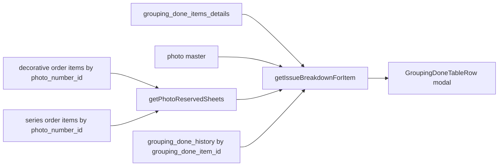
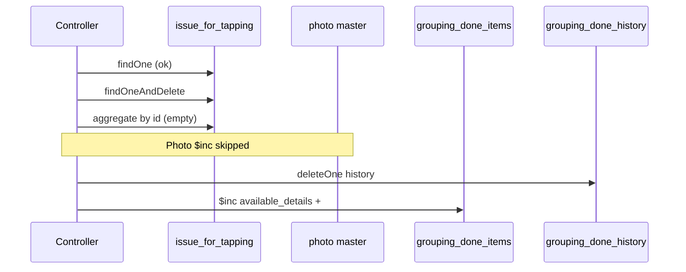

# Grouping Done: Issue Breakdown, Damage, and Revert Issue for Tapping

**Date:** 2026-10-16  
**Scope:** `fetch-issue-breakdown`, `add-grouping-done-damaged-items`, `revert-issue-for-tapping-item`  
**Related routes:**

| Route | Handler |
|-------|---------|
| `GET /factory/grouping-done/fetch-issue-breakdown/:id` | `fetch_issue_breakdown` → `getIssueBreakdownForItem` |
| `POST /factory/grouping-done/add-grouping-done-damaged-items/:id` | `add_grouping_done_damaged` |
| `POST /factory/tapping/issue-for-tapping/revert-issue-for-tapping-item/:issue_for_tapping_id` | `revert_issue_for_tapping_item` |

**Frontend:** `topl_frontend/src/app/pages/Factory/Grouping/GroupingDone/Components/GroupingDoneTableRow.js`

---

## 1. Business scenario (your example)

| Group / photo | Sheets created in grouping done | Notes |
|---------------|----------------------------------|--------|
| g1p1 | 200 | Order created for 100 sheets; photo assigned on order uses this group/photo |
| g2p2 | 100 | No order (or not fully allocated) |
| g3p3 | 50 | No order |

**Expected in “Add to damage” / issue modal (per row, e.g. g1p1):**

- After order reserves 100 sheets against the photo/group: **100 available**, **100 reserved** (for order), not issued from factory yet.
- g2p2 / g3p3 should show **reserved** only for orders tied to **that** group/photo, not unrelated totals.

**Observed:**

- g1p1: `Reserved For Order: 440`
- g2p2: `Reserved For Order: 540`
- g3p3: `Reserved For Order: 520`

Those numbers differ per row but are far larger than 100 and are not consistent with “200 − 100 reserve” logic.

---

## 2. How issue breakdown is built today

### 2.1 API entry

```2890:2902:topl_backend/controllers/factory/grouping/grouping_done.controller.js
export const fetch_issue_breakdown = catchAsync(async (req, res, next) => {
  const { id } = req.params;

  const result = await getIssueBreakdownForItem({
    itemModel: grouping_done_items_details_model,
    itemId: id,
    historyModel: grouping_done_history_model,
    historyMatchField: 'grouping_done_item_id',
  });
  // ...
});
```

### 2.2 `getIssueBreakdownForItem` (`topl_backend/utils/getIssueBreakdown.js`)

| Response field | Source | Meaning |
|----------------|--------|---------|
| `available_sheets` | `grouping_done_items_details.available_details.no_of_sheets` | **Per grouping-done line** (correct for row) |
| `group_total_sheets` | Photo master `no_of_sheets` | **Entire photo** stock |
| `group_available_sheets` | Photo master `available_no_of_sheets` | **Entire photo** availability |
| `reserved_for_order_sheets` | `getPhotoReservedSheets(photo_no_id)` | Sum of **all open order line items** (decorative + series) matching `photo_number_id` **or** `different_group_photo_number_id` on that photo |
| `issued_*_sheets` | Sum from `grouping_done_history` grouped by `issued_for` (`ORDER`, `STOCK`, `SAMPLE`) | Factory issues **from this grouping line** only |

### 2.3 Root cause — issue 1 (wrong “Reserved For Order”)

**`reserved_for_order_sheets` is photo-global, not grouping-line-global.**

`buildReservationPipeline(photo_no_id)`:

- Matches every active order item pointing at that **photo master id** (both decorative and series collections).
- Sums `no_of_sheets` (×2 when `pressing_instructions === 'BOTH SIDE WITH SAME GROUP'`).
- Does **not** filter by `group_no` / `group_number`, pallet, or this `grouping_done_items_details` row.

So for g1p1, **440** is plausibly “all open orders on that photo in the system,” not “100 reserved for the current order on this sheet line.”

**Why g2p2 (540) and g3p3 (520) also look wrong**

Each row uses its own `photo_no_id`. Each photo gets its **own** global sum. The UI labels it as if it were reserved **for this grouping row**, but the number is **shared photo-level demand** from many orders.

**Additional confusion — UI binds the wrong “available” field**

In `GroupingDoneTableRow.js`, the disabled “Available Sheets” field uses:

```javascript
value={breakdownData?.group_available_sheets || 0}
```

not `breakdownData.available_sheets` (item-level). So users see **photo master** availability while “Reserved For Order” is also **photo-level**, but **issued** counts are **item-level** — mixed scopes on one panel.

**Existing but unused group-scoped helper**

The same file defines `getReservedOrdersForGroupNo(group_number)` using `buildReservationPipeline2`, which matches order items on `group_number` / `different_group_number`. That aligns better with per–group-no reservation, but **`fetch-issue-breakdown` does not use it**. It uses `getPhotoReservedSheets` only.

**Note:** Grouping done stores `group_no`; order items store `group_number`. Any group-based fix must map `group_no` → order `group_number` (typically the same string value).

### 2.4 Recommended direction — issue 1

1. **Backend:** For grouping done breakdown, compute reservation **per line**, e.g.:
   - `getReservedOrdersForGroupNo(item.group_no)` and sum `reserved_sheets`, **or**
   - Derive display reserve: `max(0, no_of_sheets - available_details.no_of_sheets - issued_to_factory)` plus explicit order reservation rules your business defines.
2. **Frontend:** Show both scopes clearly, e.g.:
   - **This line:** `available_sheets`, item-level reserved (new field).
   - **Photo (master):** `group_available_sheets`, `group_total_sheets`, optional `photo_reserved_sheets` if still needed for hybrid photos.
3. **Hybrid photos:** One photo document can hold multiple `group_no` via `hybrid_group_no`; photo-level sums will **always** overstate reserve for a single line unless scoped by group.

---

## 3. Issue 2 — partial damage shows full line in damage tab / export

### 3.1 What the UI sends

Damage submit (`GroupingDoneTableRow.js`) posts:

```javascript
Axios.post(addToDamage(e._id), {
  no_of_sheets: values.issue_no_of_sheets,
  issued_date: values.issued_date.format("YYYY-MM-DD"),
});
```

The modal allows `issue_no_of_sheets` &lt; full `available_details.no_of_sheets` (validation uses item available and `group_available_sheets`).

### 3.2 What the backend does

`add_grouping_done_damaged` (`grouping_done.controller.js`):

1. **Rejects** if `no_of_sheets !== available_details.no_of_sheets` (entire line must still be “unissued”).
2. Ignores `req.body.no_of_sheets` completely.
3. Sets `is_damaged: true` on the **whole** `grouping_done_items_details` document.
4. Does **not** decrement `no_of_sheets` or `available_details.no_of_sheets`.
5. Does **not** create a second line for remaining good sheets.

So:

| User action | Expected | Actual |
|-------------|----------|--------|
| 100 available, mark 10 damaged | 90 available on grouping list; damage reports show 10 | If API accepts at all, full row flagged `is_damaged`; reports use **full** `no_of_sheets` for damage columns |
| Export “available 100, damage 100” | Inconsistent partial state | Consistent with **full-row damage flag** + unchanged `no_of_sheets` |

**Reports** (e.g. grouping daily / stock register) treat damage as:

- `damaged_sheets`: full `no_of_sheets` when `is_damaged === true`
- `issue_sheets`: `available_details.no_of_sheets`

With full-row damage and no quantity change, you can see **available 100** and **damage 100** on the same logical stock — double counting in reports.

### 3.3 Recommended direction — issue 2

Pick one product rule and implement end-to-end:

**Option A — partial damage (matches UI)**

- Accept `no_of_sheets` (or `damage_no_of_sheets`) in body.
- Validate `<= available_details.no_of_sheets`.
- `$inc` available (and sqm/amount proportionally); optionally `$inc` a `damaged_details` subdocument or insert a damage history row.
- Set `is_damaged: true` only when **all** sheets damaged, **or** always keep `is_damaged` false until fully damaged and use a separate damage ledger.

**Option B — full-line damage only (matches current API guard)**

- Remove partial quantity from the damage modal (force full line).
- Hide `issue_no_of_sheets` for damage or set it read-only to full available.

Today **UI implies Option A; API implements Option B** — that is the core defect.

---

## 4. Issue 3 — revert issue for tapping does not restore grouping done / photo correctly

### 4.1 Happy-path issue for order (reference)

`issue_for_tapping_from_grouping_for_order` (`grouping.issue_for_order.controller.js`):

1. Creates `issue_for_tapping` with `issued_for: ORDER`.
2. Inserts `grouping_done_history` (with `issue_for_tapping_id`).
3. `$inc` negative on `available_details` on the grouping line.
4. If order photo ≠ group photo, `$inc` negative on photo `available_no_of_sheets`.
5. Sets parent `grouping_done_details.isEditable: false`.

### 4.2 Revert flow (`revert_issue_for_tapping_item`)

Intended steps:

1. Load tapping record.
2. Delete tapping record.
3. Restore photo sheets (order case).
4. Delete matching `grouping_done_history`.
5. `$inc` **positive** on grouping `available_details` by deleted tapping quantities.
6. If all lines fully available again, set `isEditable: true`.

### 4.3 Bug — photo restore runs after delete and re-queries deleted id

Order revert calls `revert_photo_no_of_sheets()`, which **aggregates `issue_for_tapping` by `_id` after the document was deleted**:

```javascript
// Deleted earlier:
await issue_for_tapping_model.findOneAndDelete({ _id: ... }, { session });

// Later inside revert_photo_no_of_sheets:
const [fetch_issue_for_tapping_item_details] = await issue_for_tapping_model.aggregate([
  { $match: { _id: new mongoose.Types.ObjectId(issue_for_tapping_id) } },
  // ...
]);
```

After delete, aggregation returns **no row**. Photo increment is **skipped**, even when issue had decremented photo `available_no_of_sheets` (order photo ≠ group photo).

**Fix:** Use the `fetch_issue_for_tapping_item_details` loaded **before** delete (and optional lookup already defined in that function), or pass deleted document from `findOneAndDelete` into the photo restore logic.

### 4.4 Other revert edge cases

| Topic | Behavior | Risk |
|-------|----------|------|
| History delete | Requires `issue_for_tapping_id` + `grouping_done_item_id` + `grouping_done_other_details_id` | If history row missing or ids mismatch, revert **throws** and rolls back; grouping line can stay reduced |
| `available_details` restore | Adds back `delete_issue_for_tapping_item.no_of_sheets` | Correct for single issue; multiple partial issues need multiple reverts in reverse order |
| `isEditable` | Set true only when **every** item under parent has `no_of_sheets === available_details.no_of_sheets` | Correct if available was restored; wrong if photo master still out of sync |
| Stock/sample issues | No photo adjustment on issue | Revert photo path only runs for `issued_for === ORDER` — OK |

### 4.5 Symptom mapping (“grouping done not back to initial state”)

After revert, users may see:

- **Grouping line:** `available_details` restored but **photo master** still low → breakdown modal shows odd `group_available_sheets` vs `available_sheets`.
- **Reserved for order:** Still photo-global (issue 1), so numbers do not return to an intuitive “initial” view even when revert succeeds.
- **Failure mid-transaction:** History delete failure leaves issued quantity on grouping line without tapping row.

---

## 5. End-to-end flow (mermaid)

### 5.1 Issue breakdown (current)



### 5.2 Revert (current — photo bug)



---

## 6. Suggested test matrix

| # | Steps | Expected after fixes |
|---|--------|----------------------|
| 1 | Create g1p1=200, g2p2=100, g3p3=50; order 100 sheets on g1p1 photo | g1p1 modal: item available 200 (or per your reserve rules), **reserved 100** scoped to group; g2/g3 reserved 0 or per their orders only |
| 2 | Issue 50 sheets ORDER from g1p1 | `available_sheets` 150; `issued_order_sheets` 50; photo available decremented only when order photo ≠ group photo |
| 3 | Revert that issue for tapping | Same as before issue; photo master matches; `isEditable` true if no other issues |
| 4 | 100 available on line; damage 10 | Line shows 90 available; damage reports 10; row stays on main list |
| 5 | Full damage 100 | Row moves to damage tab; `is_damaged`; reports damage 100; available 0 |

---

## 7. File change checklist (when implementing)

| Area | File | Change |
|------|------|--------|
| Reservation scope | `topl_backend/utils/getIssueBreakdown.js` | Use group-based reservation for grouping module; expose `item_available_sheets` vs photo fields explicitly |
| Breakdown API | `grouping_done.controller.js` | Optional: pass `group_no` into breakdown |
| Damage | `add_grouping_done_damaged` | Partial damage + proportional sqm/amount; or align validation with UI |
| Reports | grouping daily / stock register controllers | If partial damage: use damaged quantity field, not full `no_of_sheets` when `is_damaged` |
| Revert | `issue_for_tapping.controller.js` | Photo restore from pre-delete document; add test for order photo ≠ group photo |
| UI | `GroupingDoneTableRow.js` | Bind “Available Sheets” to `available_sheets`; label photo vs line reserve |

---

## 8. Summary

| Issue | Root cause | Severity |
|-------|------------|----------|
| **1 — Reserved 440 / 540 / 520** | `reserved_for_order_sheets` sums **all orders on photo id**; UI mixes photo-level available with item-level issued | High — misleading operations |
| **2 — Partial damage** | Frontend sends partial `no_of_sheets`; backend marks **entire** row damaged and ignores quantity; reports count full sheets | High — data + export wrong |
| **3 — Revert** | Photo restore aggregates **after delete** → no restore when photo was adjusted on issue | High — stock drift after revert |

This document is analysis only; no runtime behavior was changed in the codebase when it was written.
