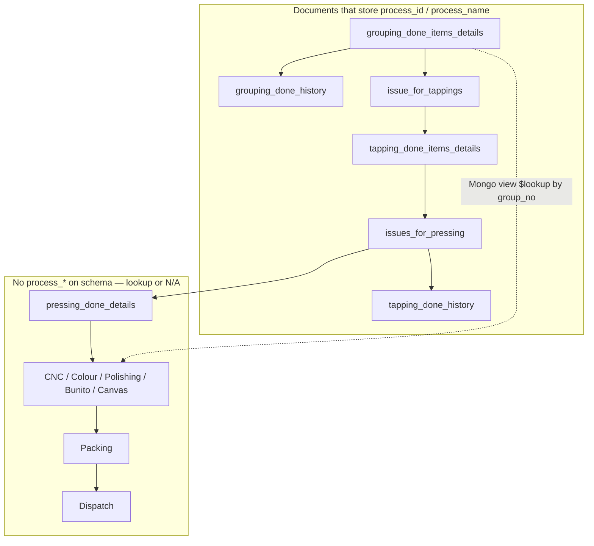

# Impact: Optional `process_id` / `process_name` (Factory Flow)

## 1. Purpose

Grouping Done lines may be saved **without** selecting a Process master value. The fields `process_id` and `process_name` are **denormalized copies** of the Process master. They are copied along the **Grouping → Tapping → Pressing** stock path on issue documents, done line items, and history collections.

If `required` is removed only on one schema, later steps can still throw Mongo validation errors (`process id is required` / `process name is required`).

This document covers:

- **What code changes are required** (schemas vs no-change areas)
- Where process is **stored** vs **looked up**
- **Controllers**, **frontend**, **reports**, and downstream factories

---

## 2. Changes required — summary (current repo)

### 2.1 Backend schemas — **MUST change** (comment `required`, add `default: null`)

All paths under `topl_backend/database/schema/factory/`.

| # | File | Collection / sub-schema | Status today | Action |
|---|------|-------------------------|--------------|--------|
| 1 | `grouping/grouping_done.schema.js` | `grouping_done_items_details` | `required` **already commented** | Optional: add `default: null` on both fields |
| 2 | `grouping/grouping_done_history.schema.js` | `grouping_done_history` | `required` **commented** | Done |
| 3 | `tapping/issue_for_tapping/issue_for_tapping.schema.js` | `issue_for_tappings` | `required` **commented** | Done |
| 4 | `tapping/tapping_done/tapping_done.schema.js` | `tapping_done_items_details` | `required` **commented** | Done |
| 5 | `tapping/tapping_history/tapping_done_history.schema.js` | `tapping_done_history` | `required` **commented** | Done |
| 6 | `pressing/issues_for_pressing/issues_for_pressing.schema.js` | `issues_for_pressing` | `required` **commented** | Done |

**Exact edit (each of rows 2–6):** remove or comment `required: [true, ...]` on `process_id` and `process_name`; set `default: null` (match `issues_for_grouping.schema.js`).

### 2.2 Backend schemas — **already OK** (no change for Grouping → Pressing chain)

| File | Notes |
|------|--------|
| `grouping/issues_for_grouping.schema.js` | `default: null`, not required |
| `pressing/pressing_done/pressing_done.schema.js` | No `process_id` / `process_name` |
| `pressing/pressing_history/pressing_done_history.schema.js` | No process fields |
| `factory/cnc/**`, `colour/**`, `polishing/**`, `bunito/**`, `canvas/**` issue & done schemas | No `process_*` on document |
| `database/schema/packing/**` | No process fields |
| `database/schema/dispatch/**` | No process fields |

### 2.3 Backend schemas — **only if Smoking & Dying must allow empty process**

| File | Action |
|------|--------|
| `smoking_dying/smoking_dying_done.schema.js` | Two sub-schemas both **require** `process_*` today — relax only if product needs it |
| `smoking_dying/issues_for_smoking_dying.schema.js` | Already optional — **no change** |

### 2.4 Backend controllers / routes — **no change expected**

Process is only copied (`process_id: data?.process_id`, `process_name: data?.process_name`) or spread into history. After schemas allow null/undefined, these keep working:

- `controllers/factory/tapping/issue_for_tapping/issue_for_tapping.controller.js`
- `controllers/factory/tapping/tapping_done/tapping_done.controller.js`
- `controllers/factory/pressing/issues_for_pressing/issues_for_pressing.controller.js`
- `controllers/factory/grouping/grouping.issue_for_order.controller.js`
- `controllers/factory/grouping/issues_for_grouping.controller.js`
- `controllers/order/raw_order/issue_for_order/grouping_factory/issue_for_order.controller.js`
- `controllers/challan/issue_for_challan/issue_for_challan.js`
- `controllers/factory/grouping/grouping_done_bulk_upload.controller.js` (blank Excel process already allowed)

### 2.5 Frontend — **no mandatory change**

| Area | Change |
|------|--------|
| Grouping Create/Edit | Yup `process_name` required already commented in several `EditItemTable.js` / `addNewItemTable.js` — keep optional |
| Tapping / Pressing lists | Already `process_name \|\| "-"` |
| CNC, Colour, Polishing, Bunito, Canvas, Packing, Dispatch | Display via `grouping_details.process_name` or `"-"` — **no schema-related FE work** |
| Optional hardening | Send `process_id: null`, `process_name: null` instead of `""` on save APIs |

### 2.6 Reports / Excel — **no code change required** (behaviour only)

| Item | Impact when process empty |
|------|---------------------------|
| `config/downloadExcel/Logs/Factory/Grouping/groupingHistory.js` | Process column blank |
| `controllers/reports2/Grouping_Splicing/groupingSplicingStockRegister.js` | Hand-splice match may skip rows — **confirm with business** |
| Tapping / Pressing reports | Generally unaffected |
| Smoking & Dying Excel | Still expects process on S&D lines if that module keeps required |

### 2.7 Data migration

**None.** Existing documents keep process values; new rows may omit or null process fields.

### 2.8 Test after schema changes

1. Grouping Done **without** Process → save OK (already if `grouping_done` relaxed).
2. Issue for Tapping (stock/sample) → no validation error.
3. Grouping History row created → no validation error.
4. Tapping Done create → no validation error.
5. Issue for Pressing → no validation error; Tapping Done History row created.
6. Pressing Done → create (uses `flow_process`, not `process_name`).
7. Open Issue for Polishing/CNC modal → Process shows `-` if grouping line had no process.

---

## 3. Business flow vs process-field flow

| Question | Answer |
|----------|--------|
| Is Pressing the last **factory step**? | **No.** After Pressing Done, items can go to CNC, Colour, Polishing, Bunito, Canvas, then Packing, Dispatch, etc. |
| Is Pressing the last step that **stores** `process_id` / `process_name` on Mongo documents? | **Yes**, for the veneer chain: last collections with those fields are typically **`issues_for_pressing`** and **`tapping_done_history`** (when issuing tapping stock to pressing). |
| What does Pressing Done use instead? | **`flow_process`** (array) on `pressing_done_details` — next factories from product/master, **not** the same as `process_name` on grouping lines. |

---

## 4. Data flow (stores `process_id` / `process_name`)



| Step | How process is set |
|------|---------------------|
| Grouping Done create/edit | FE sends `process_id` / `process_name` (optional in UI if Yup required is commented). |
| Issue for Grouping | `issues_for_grouping` — optional (`default: null`). |
| Issue for Tapping (from Grouping) | `issue_for_tapping.controller.js` copies `process_id` / `process_name` from grouping done item. |
| Grouping Done History | Spread from issue-for-tapping document on issue. |
| Tapping Done | `items_details` from API/FE (usually from issue-for-tapping line). |
| Issue for Pressing (from Tapping Done) | `issues_for_pressing.controller.js` copies from tapping done item. |
| Tapping Done History | Spread from issue-for-pressing document when issuing to pressing. |

Controllers **do not** re-validate against Process master; **mongoose `required`** on each collection causes failures when values are missing.

---

## 5. CNC, Colour, Polishing, Bunito, Canvas, Packing, Dispatch

These modules are **not** part of mongoose **required `process_id` / `process_name`** validation for the grouping line.

| Module | `process_id` / `process_name` on issue/done schema? | How “Process” shows in portal |
|--------|-----------------------------------------------------|-------------------------------|
| Issue for CNC / Colour / Polishing / Bunito / Canvas | **No** | Views e.g. `issue_for_polishing_details_view` `$lookup` **`grouping_done_items_details`** via `pressing_details.group_no` → **`grouping_details.process_name`** |
| Done / history for those factories | **No** `process_*` fields | Modals often use `grouping_details.process_name` or `"-"` |
| Packing | **No** | Not in packing schemas |
| Dispatch | **No** | Not in dispatch schemas |

**Impact if grouping has no process:** downstream screens may show **blank / "-"** only — **no extra schema changes** needed for CNC → Dispatch for this task.

**Separate module:** **Smoking & Dying** — `smoking_dying_done.schema.js` still **requires** `process_id` / `process_name` (different branch from pressing).

---

## 6. Backend controllers (copy / history)

Usually **no logic change** — only schema relaxation. These **pass through** `process_*`:

| Module | File |
|--------|------|
| Issue for Tapping | `controllers/factory/tapping/issue_for_tapping/issue_for_tapping.controller.js` |
| Tapping Done | `controllers/factory/tapping/tapping_done/tapping_done.controller.js` |
| Issue for Pressing | `controllers/factory/pressing/issues_for_pressing/issues_for_pressing.controller.js` |
| Issue for Grouping / order | `controllers/factory/grouping/grouping.issue_for_order.controller.js` |
| Issues for Grouping | `controllers/factory/grouping/issues_for_grouping.controller.js` |
| Grouping Done bulk upload | `controllers/factory/grouping/grouping_done_bulk_upload.controller.js` (process column optional in Excel) |

**Other grouping history writers** (confirm spread includes optional process):

- `controllers/order/raw_order/issue_for_order/grouping_factory/issue_for_order.controller.js`
- `controllers/challan/issue_for_challan/issue_for_challan.js`

---

## 7. Symptom → likely failing layer

| User action | Likely failing schema |
|-------------|------------------------|
| Issue for Tapping (no process on group) | `issue_for_tappings` |
| Grouping history after issue to tapping | `grouping_done_history` |
| Save Tapping Done | `tapping_done_items_details` |
| Issue for Pressing from Tapping Done | `issues_for_pressing` |
| Tapping Done History after issue to pressing | `tapping_done_history` |
| Issue to CNC / Colour / Polishing / Packing | **Unlikely** — no `process_*` required on those schemas |
| Smoking & Dying done | `smoking_dying_done` if process empty |

---

## 8. Reports & Excel

| Area | Path | Note if `process_name` empty |
|------|------|------------------------------|
| Grouping history export | `config/downloadExcel/Logs/Factory/Grouping/groupingHistory.js` | Blank Process column |
| Grouping / splicing stock register | `controllers/reports2/Grouping_Splicing/groupingSplicingStockRegister.js` | Hand-splice logic uses `process_name` regex — confirm with business |
| Tapping stock / daily | `controllers/reports2/Tapping/**`, `config/downloadExcel/reports2/Tapping/**` | Generally not gated on process |
| Smoking & Dying reports | `config/downloadExcel/reports2/Smoking&Dying/**` | Expect process on S&D lines |

---

## 9. Frontend (`topl_frontend`)

| Area | Path | Notes |
|------|------|--------|
| Grouping Create / Edit | `Factory/Grouping/CreateGrouping/*`, `GroupingDone/EditGrouping/*` | Yup `process_name` required often **commented** |
| Grouping History | `Factory/Grouping/GroupingHistory/**` | `process_name \|\| "-"` |
| Tapping | `Factory/TappingFactory/**` | Lists + create/edit copy process from issue line |
| Issue for Pressing | `Factory/PressingFactory/IssueForPressing/**` | Display only |
| Pressing Done | `Factory/PressingFactory/CreatePressing/**` | **`flow_process`**, not line `process_name` |
| Polishing / Colour / CNC modals | `**/ItemDetailModal.js` | `grouping_details.process_name \|\| "-"` |

Optional FE hardening: send `null` instead of `""` for missing process if validators treat empty string differently.

---

## 10. Reference pattern (optional fields)

```javascript
process_id: {
  type: mongoose.Schema.Types.ObjectId,
  default: null,
  // required: [true, 'process id is required'],
},
process_name: {
  type: String,
  uppercase: true,
  trim: true,
  default: null,
  // required: [true, 'process name is required'],
},
```

---

*Document path: `topl_backend/docs/factory/PROCESS_FIELDS_OPTIONAL_IMPACT.md`*
